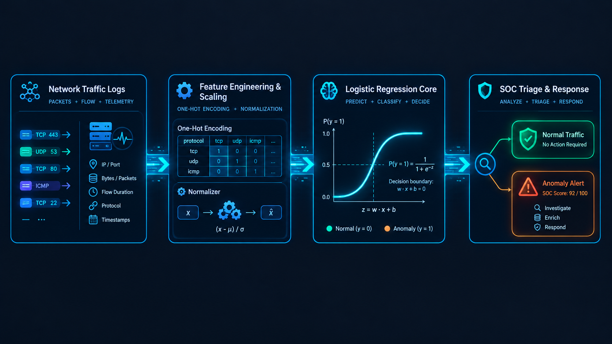

# Network Intrusion Detection — Logistic Regression

Classification binaire de connexions réseau (**normal** / **anomalie**) par régression logistique, avec une lecture orientée **SOC**, **architecture de sécurité** et **IA**.

## Objectif

Construire un modèle léger et interprétable capable de signaler des connexions suspectes à partir de statistiques de trafic, puis en analyser les forces, les limites et l'impact opérationnel (faux positifs, attaques non détectées, choix du seuil).

## Données

- Source : [Network Intrusion Detection (Kaggle)](https://www.kaggle.com/datasets/sampadab17/network-intrusion-detection), fichier `Train_data.csv`.
- 25 192 connexions, 41 variables et la cible `class` (`normal` / `anomaly`).
- 3 variables qualitatives (`protocol_type`, `service`, `flag`) et 38 quantitatives.
- Qualité : aucune valeur manquante, aucun doublon. Classes équilibrées (53,4 % normal / 46,6 % anomalie).
- Le fichier `Test_data.csv` ne contient pas d'étiquettes : il n'est pas utilisé pour l'évaluation.

Les données ne sont pas incluses dans ce dépôt (voir la licence du dataset sur Kaggle).

## Méthodologie

1. **Chargement** depuis Google Drive (montage dans Colab).
2. **Exploration** : dimensions, équilibre des classes, valeurs manquantes, doublons, types.
3. **Préparation** :
   - cible binaire : `anomaly` = 1, `normal` = 0 ;
   - encodage one-hot de `protocol_type`, `service` et `flag` (118 variables au total) ;
   - séparation 80 / 20 stratifiée (`random_state=42`) : 20 153 observations d'entraînement, 5 039 de test ;
   - normalisation avec `StandardScaler`, ajusté sur l'entraînement uniquement pour éviter toute fuite de données.
4. **Modèle** : `LogisticRegression(max_iter=1000)`, convergence en 94 itérations.
5. **Évaluation** : accuracy, matrice de confusion, precision / recall / F1, analyse du seuil de décision.
6. **Tests de scénarios** : connexions réelles du jeu de test et analyse de sensibilité.

## Résultats

| Métrique | Valeur |
|---|---|
| Accuracy | 97,28 % |
| Precision (anomalie) | 0,98 |
| Recall (anomalie) | 0,96 |
| F1 (anomalie) | 0,97 |

Matrice de confusion (jeu de test, 5 039 connexions) :

|  | Prédit normal | Prédit anomalie |
|---|---|---|
| **Réel normal** | 2 640 | 50 (faux positifs) |
| **Réel anomalie** | 87 (non détectées) | 2 262 |

### Effet du seuil de décision

| Seuil | Attaques manquées (FN) | Fausses alertes (FP) | Recall | Precision |
|---|---|---|---|---|
| 0,2 | 56 | 126 | 0,976 | 0,948 |
| 0,3 | 65 | 87 | 0,972 | 0,963 |
| 0,5 | 87 | 50 | 0,963 | 0,978 |
| 0,7 | 114 | 27 | 0,951 | 0,988 |

## Interprétation du modèle

Variables les plus associées à une anomalie (coefficients sur données normalisées) : `num_compromised` (+3,56), `srv_serror_rate` (+2,82), `count` (+1,90), `srv_rerror_rate` (+1,71), `service_private` (+1,47), `flag_S0` (+1,42).

Attention : certaines variables sont fortement corrélées (par exemple `serror_rate` et `srv_serror_rate`, ou `num_root` et `num_compromised`), ce qui peut inverser le signe de certains coefficients. Ils décrivent ce modèle, pas une relation causale.

## Lecture métier

### SOC
- Un faux négatif est une attaque non détectée : l'attaquant reste actif sans alerte. Le recall de la classe anomalie est l'indicateur prioritaire.
- Un faux positif consomme du temps d'analyste et crée de la fatigue d'alerte.
- Les signaux dominants (`flag_S0`, `srv_serror_rate`, `count`) correspondent à des scénarios de scan et de déni de service, traduisibles en règles de détection (Suricata, SIEM).

### Architecte sécurité
- Le modèle est une couche de scoring légère, rapide et auditable, à compléter par EDR, NDR, filtrage et authentification forte (défense en profondeur).
- Le seuil est une décision de conception : bas pour les actifs critiques, plus haut si la capacité de triage est limitée.
- En production : pipeline d'encodage et de normalisation identique à l'entraînement, versionnage du modèle, réentraînement périodique, surveillance de la dérive, protection contre l'empoisonnement et l'évasion.

### IA
- La normalisation est indispensable pour la régression logistique et rend les coefficients comparables.
- L'accuracy est fiable ici grâce à l'équilibre des classes ; avec des attaques rares, il faudrait privilégier recall, precision, F1 et courbe PR.
- L'analyse de sensibilité montre des effets non additifs : sur une connexion normale (probabilité 0,001), `count = 400` donne 0,33, puis l'ajout de `srv_serror_rate = 1` donne 0,996.

## Limites

- Dataset ancien (famille KDD / NSL-KDD) : le trafic et les attaques ne reflètent pas l'environnement actuel.
- Les attaques discrètes (abus d'un service légitime, comptes valides, comportement lent) passent sous le seuil : exemple d'une connexion FTP classée normale avec une probabilité de 0,355 alors qu'elle était malveillante.
- Une seule évaluation sur un découpage fixe : une validation croisée et un test sur un jeu récent (CIC-IDS2017, UNSW-NB15) seraient nécessaires avant toute conclusion sur la généralisation.

## Pistes d'amélioration

- Comparer avec Random Forest et XGBoost.
- Réduire la multicolinéarité (sélection de variables, régularisation).
- Ajouter des variables contextuelles : heure, géolocalisation, réputation d'IP, ratio d'octets, fenêtres temporelles.
- Intégrer le modèle à une chaîne de détection (Wazuh, Suricata).

## Exécution

1. Ouvrir le notebook Colab via le badge ci-dessus.
2. Télécharger `Train_data.csv` depuis Kaggle et le placer dans Google Drive, dans `AI-Cyber/archive/`.
3. Monter Drive et exécuter les cellules dans l'ordre.

Bibliothèques : `pandas`, `numpy`, `scikit-learn`.

## Auteur

Othmane — [GitHub](https://github.com/othmane71-art)
